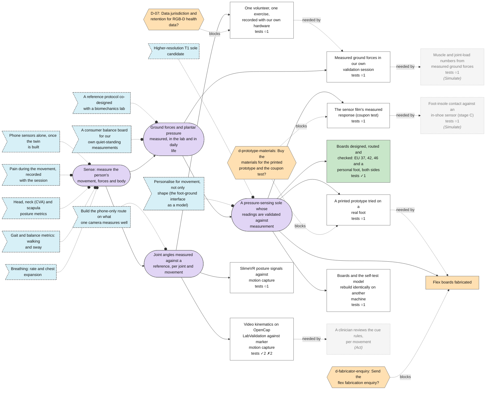
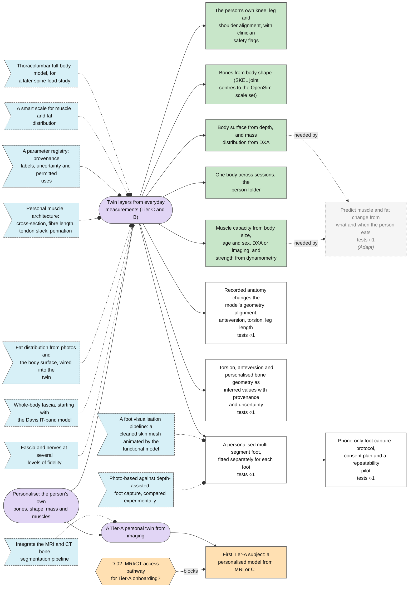
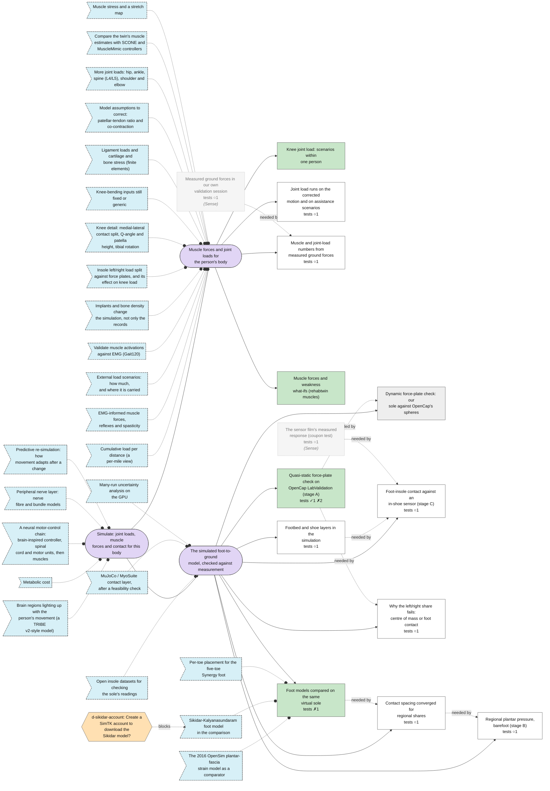
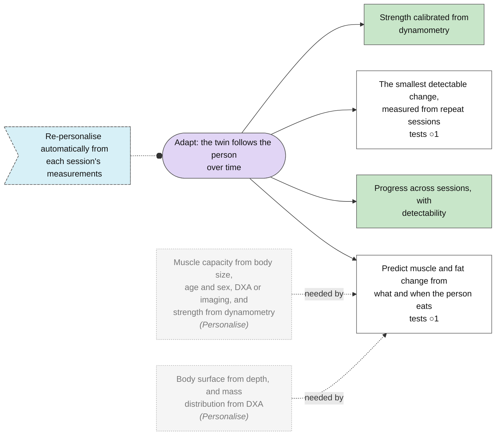
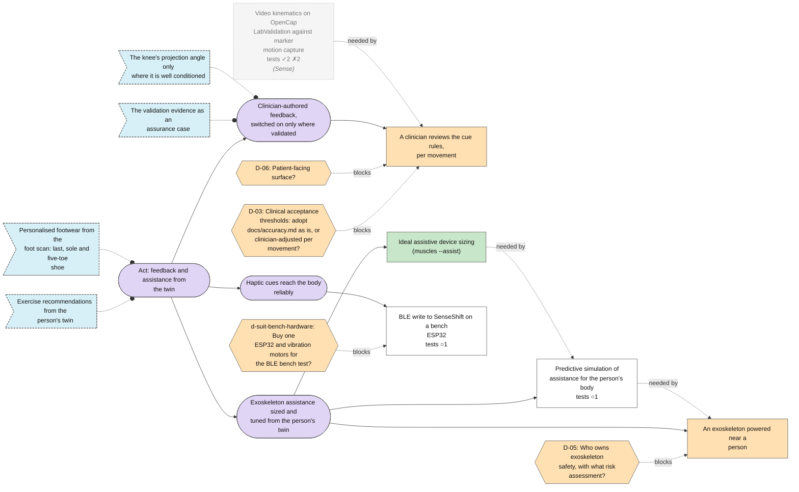
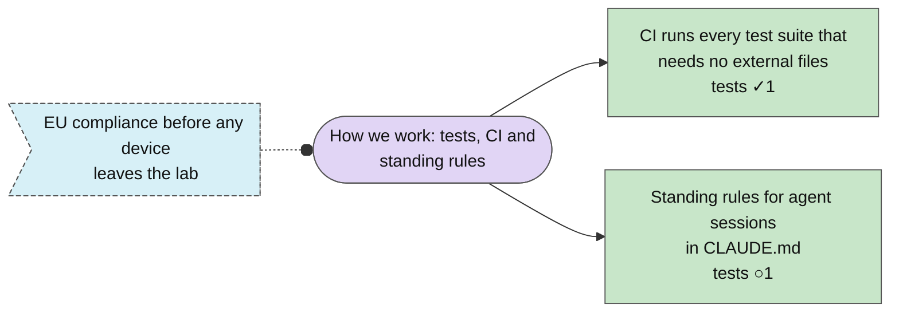

<!-- Generated by plan/build.py from plan/nodes/. Do not edit; edit the notes and run the script. -->

# Plan map

170 notes: 17 goals, 42 steps, 34 tests, 52 ideas, 25 decisions.

## The engine

## Sense: measure the person's movement, forces and body

## Personalise: the person's own bones, shape, mass and muscles

## Simulate: joint loads, muscle forces and contact for this body

## Adapt: the twin follows the person over time

## Act: feedback and assistance from the twin

## How we work: tests, CI and standing rules

## Inbox

0 unsorted ideas in `plan/inbox.md`; the next session turns each into a note.

## Needs your input

- D-01: open decision: iPhone: fixed tripod viewpoint or moving main camera?
- D-02: open decision: MRI/CT access pathway for Tier-A onboarding?
- D-03: open decision: Clinical acceptance thresholds: adopt docs/accuracy.md as is, or clinician-adjusted per movement?
- D-04: open decision: Ground truth for kinematics validation: LabValidation now, then a gait-lab collaboration?
- D-05: open decision: Who owns exoskeleton safety, with what risk assessment?
- D-06: open decision: Patient-facing surface?
- D-07: open decision: Data jurisdiction and retention for RGB-D health data?
- D-09: open decision: SKEL/SMPL licensing for anything beyond research?
- D-10: open decision: Gravity reference for monocular captures?
- D-11: open decision: Monocular front-end: HSMR/SKEL, OpenCap Monocular or SAM4Dcap?
- d-commercial-route: open decision: Which commercialisation and licensing route does the project take?
- d-compute-location: open decision: Edge (phone), desktop or cloud computing for each stage?
- d-fabricator-enquiry: open decision: Send the flex fabrication enquiry?
- d-feature-release-rule: open decision: What must an output pass before a consumer feature is allowed to report it?
- d-moticon-enquiry: open decision: Send the drafted Moticon quote request (bilateral raw data, sensor geometry, calibration, SDK terms)?
- d-prototype-materials: open decision: Buy the materials for the printed prototype and the coupon test?
- d-repo-visibility: open decision: Keep rehab-agent public, or make it private?
- d-sikidar-account: open decision: Create a SimTK account to download the Sikidar model?
- d-suit-bench-hardware: open decision: Buy one ESP32 and vibration motors for the BLE bench test?
- d-wearables-tier: open decision: Do optional wearables and pressure hardware belong in a later research or advanced tier?
- sole-physical-prototype: priority-1 step needs a stop rule (a number, a date, an owner)
- t-anatomy-geometry: no expected result: write it before the test runs
- t-bone-geometry: no expected result: write it before the test runs
- t-exo-assist: no expected result: write it before the test runs
- t-foot-capture-pilot: no expected result: write it before the test runs
- t-footbed: no expected result: write it before the test runs
- t-forces-session: no expected result: write it before the test runs
- t-insole: no expected result: write it before the test runs
- t-joint-load-scenarios: no expected result: write it before the test runs
- t-kin-volunteer: no expected result: write it before the test runs
- t-loads-measured-forces: no expected result: write it before the test runs
- t-nutrition-dxa: no expected result: write it before the test runs
- t-personalised-foot: no expected result: write it before the test runs
- t-prototype-press: no expected result: write it before the test runs
- t-regional: no expected result: write it before the test runs
- t-slimevr: no expected result: write it before the test runs
- t-smallest-detectable-change: no expected result: write it before the test runs
- t-suit-ble: no expected result: write it before the test runs

## Ready to work on now

Open steps whose dependencies are done and that no open decision blocks.

- [[adapt-nutrition-body-composition]]: Predict muscle and fat change from what and when the person eats
- [[adapt-smallest-detectable-change]]: The smallest detectable change, measured from repeat sessions
- [[exo-assist-simulation]]: Predictive simulation of assistance for the person's body
- [[foot-capture-pilot]]: Phone-only foot capture: protocol, consent plan and a repeatability pilot
- [[kin-labvalidation]]: Video kinematics on OpenCap LabValidation against marker motion capture
- [[sim-joint-load-scenarios]]: Joint load runs on the corrected motion and on assistance scenarios
- [[sole-footbed-layers]]: Footbed and shoe layers in the simulation
- [[sole-rebuild-reproducibility]]: Boards and the self-test model rebuild identically on another machine
- [[sole-share-diagnostic]]: Why the left/right share fails: centre of mass or foot contact
- [[sole-spacing-converge]]: Contact spacing converged for regional shares
- [[suit-slimevr-validation]]: SlimeVR posture signals against motion capture
- [[twin-anatomy-into-geometry]]: Recorded anatomy changes the model's geometry: alignment, anteversion, torsion, leg length
- [[twin-bone-geometry]]: Torsion, anteversion and personalised bone geometry as inferred values with provenance and uncertainty
- [[twin-personalised-foot]]: A personalised multi-segment foot, fitted separately for each foot

## Tests

| Test | Status | Fresh | Expected | Result |
|---|---|---|---|---|
| [[t-anatomy-geometry]] | planned |  |  |  |
| [[t-boards-checker]] | passed | n/a | All eight boards pass DRC, the region map traced through the copper, numbering, coverlay and provenance | All eight pass. Passing is not a release for fabrication |
| [[t-bone-geometry]] | planned |  |  |  |
| [[t-ci-suites]] | passed | n/a | On every push, CI runs test_channel_map, test_case_store, test_compare_results, plan/test_build and plan/build.py --check, and all pass | GitHub Actions run 42722409612 on fa5c7b2, job plan-and-sole: plan check 0 errors, 14 plan tests OK, map up to date, the five sole suites 47 cases OK with none skipped |
| [[t-claude-md-fresh-session]] | planned |  | A fresh session given only a one-line task keeps every standing rule without them in the prompt |  |
| [[t-coupon]] | planned | n/a | Proposal: a material qualifies if, on 3 coupons, repeatability is within 5 % over 100 cycles, hysteresis and 10-minute creep are each at most 10 % of full scale, and the 10 mm bend shifts the baseline by at most 5 % of full scale |  |
| [[t-dyn-h1]] | dropped | no | Peak error at most 10 % of body weight (recorded mass) in every evaluated subject | Not evaluated: closed by the stop rule (amendment 7) after the v3 pilot, 2026-11-10; neither passed nor failed |
| [[t-dyn-h2]] | dropped | no | RMS error at most 15 % of foot length in every evaluated subject | Not evaluated: closed by the stop rule (amendment 7) after the v3 pilot, 2026-11-10; neither passed nor failed |
| [[t-exo-assist]] | planned |  |  |  |
| [[t-foot-capture-pilot]] | planned |  |  |  |
| [[t-footbed]] | planned |  |  |  |
| [[t-forces-session]] | planned |  |  |  |
| [[t-fp-cop]] | passed | yes | RMS error at most 10 % of foot length in every subject | Pass: median 2.85 %, range 0.97-6.67 %. Measured lies ahead of the model in every subject |
| [[t-fp-share]] | failed | yes | RMS error at most 5 points in every subject | Fail in six subjects. Post hoc, with plate coverage: subjects 4, 5, 7 and 10, up to 9.9 points |
| [[t-fp-vertical]] | failed | yes | RMS error at most 5 % of body weight in every subject | Fail in subjects 6, 9 and 10. Post hoc: follows the gap between recorded mass and plate weight (6 % in 6 and 10); 9 had a foot off the plates |
| [[t-insole]] | planned |  |  |  |
| [[t-joint-load-scenarios]] | planned |  |  |  |
| [[t-kin-labvalidation]] | failed | yes | Proposal: per route, joint and plane, the RMSE against the motion capture's inverse kinematics; a joint passes on a route if it is within docs/accuracy.md's target (sagittal at most 3 degrees, frontal at most 5) in every evaluated subject; transverse angles are reported only | Not met (2026-11-10): no sagittal cell is within 3 deg in every evaluated subject on any route; only the frontal pelvis passes (five cameras; with the augmenter also the frontal pelvis segment). 9 of 10 subjects have videos; at lag 0 |
| [[t-kin-opencap-control]] | passed | no | Proposal: through this pipeline's comparison, OpenCap's five-camera result on subject 2's squats1 has a mean absolute error over the lower-limb and trunk angles within 2 degrees of the 4.5 degrees its paper reports, with one clear lag | Met (2026-11-10): MAE over the 18 lower-limb and trunk angles 6.32 deg, +1.82 from the paper's 4.5 (16 without subtalar: 6.44); one clear lag, 0.417 s (ratio 3.02) |
| [[t-kin-opencap-control-all]] | passed | yes | For the primary configuration (HRNet, two cameras, all four activities), the mean absolute error over the 18 angles is within 2 degrees of the paper's 4.5 degrees: computed per trial, averaged over each subject's evaluated trials, then over the 10 subjects | Met (2026-11-10): primary configuration (HRNet, two cameras) 4.80 deg over the 18 angles, +0.30 from the paper's 4.5; all 10 subjects evaluated, 69 of 160 trials; walking almost never passes the clear-lag rule (1 of 60 evaluated) |
| [[t-kin-pilot]] | failed | no | Proposal: on subject 2's squats1, the comparison runs end to end for all four routes, and the five-camera route with the augmenter has an error against the motion capture within 2 degrees of its error against OpenCap at every joint | Not met (2026-11-10): all four routes ran end to end (4 run, 3 evaluated); for five cameras with the augmenter, 26 of 36 joint x plane cells differ by more than 2 deg between the errors against motion capture and against OpenCap (20 larger against motion capture, 6 smaller) |
| [[t-kin-volunteer]] | planned |  |  |  |
| [[t-loads-measured-forces]] | planned |  |  |  |
| [[t-nutrition-dxa]] | planned |  |  |  |
| [[t-personalised-foot]] | planned |  |  |  |
| [[t-prototype-press]] | planned |  |  |  |
| [[t-rebuild-laptop]] | planned |  | The design hash is 636645a928, or the first generator step whose output differs is identified |  |
| [[t-regional]] | planned |  |  |  |
| [[t-share-lever-rule]] | planned | no | If the body model is the cause, the sideways offset between measured centre of pressure and model centre of mass predicts each failing subject's share error by the lever rule within 2 points |  |
| [[t-slimevr]] | planned |  |  |  |
| [[t-smallest-detectable-change]] | planned |  |  |  |
| [[t-spacing-convergence]] | failed | n/a | The largest change between the two finest spacings is at most 1.0 point for every share and paired difference, shrinking each step | Not converged: 1.67 points from 3.75 to 2.5 mm. Shrinking: yes. Paired differences within 0.89 |
| [[t-spacing-finer]] | planned |  | The same criterion as the first convergence test, met at the next finer pair of spacings |  |
| [[t-suit-ble]] | planned |  |  |  |

## Open decisions

| Decision | Question | Blocks |
|---|---|---|
| [[D-01]] | iPhone: fixed tripod viewpoint or moving main camera? |  |
| [[D-02]] | MRI/CT access pathway for Tier-A onboarding? | ['[[twin-tier-a-subject]]'] |
| [[D-03]] | Clinical acceptance thresholds: adopt docs/accuracy.md as is, or clinician-adjusted per movement? | ['[[cues-clinician-review]]'] |
| [[D-04]] | Ground truth for kinematics validation: LabValidation now, then a gait-lab collaboration? |  |
| [[D-05]] | Who owns exoskeleton safety, with what risk assessment? | ['[[exo-hardware]]'] |
| [[D-06]] | Patient-facing surface? | ['[[cues-clinician-review]]'] |
| [[D-07]] | Data jurisdiction and retention for RGB-D health data? | ['[[kin-volunteer-recording]]'] |
| [[D-09]] | SKEL/SMPL licensing for anything beyond research? |  |
| [[D-10]] | Gravity reference for monocular captures? |  |
| [[D-11]] | Monocular front-end: HSMR/SKEL, OpenCap Monocular or SAM4Dcap? |  |
| [[d-commercial-route]] | Which commercialisation and licensing route does the project take? |  |
| [[d-compute-location]] | Edge (phone), desktop or cloud computing for each stage? |  |
| [[d-fabricator-enquiry]] | Send the flex fabrication enquiry? | ['[[sole-fabrication]]'] |
| [[d-feature-release-rule]] | What must an output pass before a consumer feature is allowed to report it? |  |
| [[d-moticon-enquiry]] | Send the drafted Moticon quote request (bilateral raw data, sensor geometry, calibration, SDK terms)? |  |
| [[d-prototype-materials]] | Buy the materials for the printed prototype and the coupon test? | ['[[sole-physical-prototype]]', '[[sole-coupon-test]]'] |
| [[d-repo-visibility]] | Keep rehab-agent public, or make it private? |  |
| [[d-sikidar-account]] | Create a SimTK account to download the Sikidar model? | ['[[idea-sikidar]]'] |
| [[d-suit-bench-hardware]] | Buy one ESP32 and vibration motors for the BLE bench test? | ['[[suit-ble-bench]]'] |
| [[d-wearables-tier]] | Do optional wearables and pressure hardware belong in a later research or advanced tier? |  |

## Decisions taken

| Decision | Question | Answer | Where |
|---|---|---|---|
| [[d-anatomy-scope]] | Do torsion, anteversion, bone geometry and the personalised foot stay in the twin? | Yes. They are retained as inferred or uncertain values with provenance; nothing is removed or shown as measured when it is not | owner's scope correction of 2026-11-02 |
| [[d-dxa-optional]] | Does the twin need a DXA scan? | No: a DXA scan gives the best generation when the person has one, but the system must work without it | owner's message of 2026-10-26 |
| [[d-dynamic-check-arm-a]] | Arm A failed the pilot gate under settings v3: amend the contact, report arm A as not solvable with the assumed contact, or pause until the coupon test? | Option 2: arm A is reported as not solvable with the assumed contact; the LabValidation dynamic comparison is closed, and H1 and H2 are not evaluated | owner, 2026-11-10 |
| [[d-first-build-platform]] | Which platform does the first build target? | Windows first; ideally, once the twin exists, a phone's sensors alone should be enough | owner's message of 2026-10-24 |
| [[d-shoe-cad-map-files]] | Put the shoe CAD capability map's files (feature table and page) into the repository? | Yes: committed to shoe-cad-map/, with its generator | owner, 2026-11-09 |

## Ideas

| Idea | Status | Title |
|---|---|---|
| [[idea-anatomy-graph]] | new | Fascia and nerves at several levels of fidelity |
| [[idea-assistance-track]] | promoted | Predictive simulation of assistance |
| [[idea-assurance-case]] | new | The validation evidence as an assurance case |
| [[idea-auto-repersonalise]] | new | Re-personalise automatically from each session's measurements |
| [[idea-balance-board]] | new | A consumer balance board for our own quiet-standing measurements |
| [[idea-bone-segmentation]] | new | Integrate the MRI and CT bone segmentation pipeline |
| [[idea-brain-activity]] | new | Brain regions lighting up with the person's movement (a TRIBE v2-style model) |
| [[idea-breathing]] | new | Breathing: rate and chest expansion |
| [[idea-cumulative-load]] | new | Cumulative load per distance (a per-mile view) |
| [[idea-emg-reflex]] | new | EMG-informed muscle forces, reflexes and spasticity |
| [[idea-eu-compliance]] | new | EU compliance before any device leaves the lab |
| [[idea-exercise-recommendation]] | new | Exercise recommendations from the person's twin |
| [[idea-external-load]] | new | External load scenarios: how much, and where it is carried |
| [[idea-fascia-it-band]] | new | Whole-body fascia, starting with the Davis IT-band model |
| [[idea-fat-from-surface]] | new | Fat distribution from photos and the body surface, wired into the twin |
| [[idea-foot-capture-comparison]] | new | Photo-based against depth-assisted foot capture, compared experimentally |
| [[idea-foot-visual-pipeline]] | new | A foot visualisation pipeline: a cleaned skin mesh animated by the functional model |
| [[idea-fppa-deep-flexion]] | new | The knee's projection angle only where it is well conditioned |
| [[idea-gait-balance]] | new | Gait and balance metrics: walking and sway |
| [[idea-gait120-emg]] | new | Validate muscle activations against EMG (Gait120) |
| [[idea-head-neck-scapula]] | new | Head, neck (CVA) and scapula posture metrics |
| [[idea-implants-bone-density]] | new | Implants and bone density change the simulation, not only the records |
| [[idea-insole-datasets]] | new | Open insole datasets for checking the sole's readings |
| [[idea-insole-split-knee-load]] | new | Insole left/right load split against force plates, and its effect on knee load |
| [[idea-knee-detail]] | new | Knee detail: medial-lateral contact split, Q-angle and patella height, tibial rotation |
| [[idea-knee-inputs]] | new | Knee-bending inputs still fixed or generic |
| [[idea-lab-reference-protocol]] | new | A reference protocol co-designed with a biomechanics lab |
| [[idea-ligament-cartilage-fe]] | new | Ligament loads and cartilage and bone stress (finite elements) |
| [[idea-metabolic-cost]] | new | Metabolic cost |
| [[idea-model-assumptions]] | new | Model assumptions to correct: patellar-tendon ratio and co-contraction |
| [[idea-more-joint-loads]] | new | More joint loads: hip, ankle, spine (L4/L5), shoulder and elbow |
| [[idea-motor-control-comparators]] | new | Compare the twin's muscle estimates with SCONE and MuscleMimic controllers |
| [[idea-movement-personalisation]] | new | Personalise for movement, not only shape (the foot-ground interface as a model) |
| [[idea-mujoco]] | new | MuJoCo / MyoSuite contact layer, after a feasibility check |
| [[idea-muscle-architecture]] | new | Personal muscle architecture: cross-section, fibre length, tendon slack, pennation |
| [[idea-muscle-stress-stretch]] | new | Muscle stress and a stretch map |
| [[idea-neural-motor-chain]] | new | A neural motor-control chain: brain-inspired controller, spinal cord and motor units, then muscles |
| [[idea-nutrition-body-composition]] | promoted | Muscle and fat change with what and when the person eats |
| [[idea-one-camera-robust-signals]] | new | Build the phone-only route on what one camera measures well |
| [[idea-pain-input]] | new | Pain during the movement, recorded with the session |
| [[idea-parameter-registry]] | new | A parameter registry: provenance labels, uncertainty and permitted uses |
| [[idea-peripheral-nerves]] | new | Peripheral nerve layer: nerve fibre and bundle models |
| [[idea-personalised-footwear]] | new | Personalised footwear from the foot scan: last, sole and five-toe shoe |
| [[idea-phone-only-capture]] | new | Phone sensors alone, once the twin is built |
| [[idea-plantar-fascia-strain-model]] | new | The 2016 OpenSim plantar-fascia strain model as a comparator |
| [[idea-predictive-resimulation]] | new | Predictive re-simulation: how movement adapts after a change |
| [[idea-sikidar]] | new | Sikidar-Kalyanasundaram foot model in the comparison |
| [[idea-smart-scale]] | new | A smart scale for muscle and fat distribution |
| [[idea-synergy-toes]] | new | Per-toe placement for the five-toe Synergy foot |
| [[idea-t1-candidate]] | new | Higher-resolution T1 sole candidate |
| [[idea-thoracolumbar-model]] | new | Thoracolumbar full-body model, for a later spine-load study |
| [[idea-uncertainty-runs]] | new | Many-run uncertainty analysis on the GPU |

## Check

0 errors, 0 warnings.
