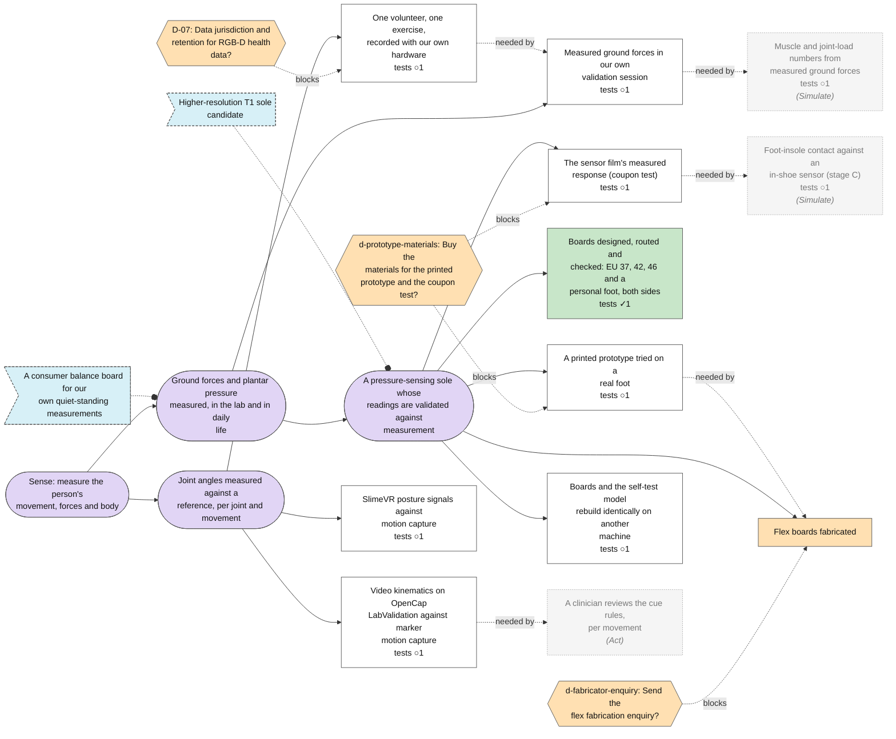
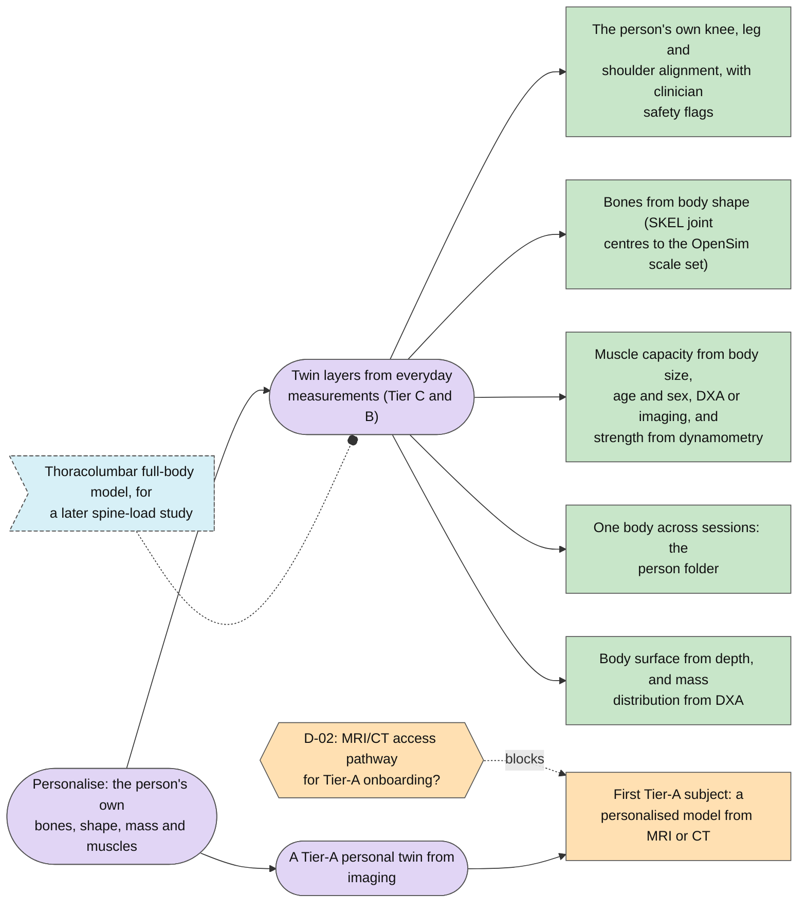
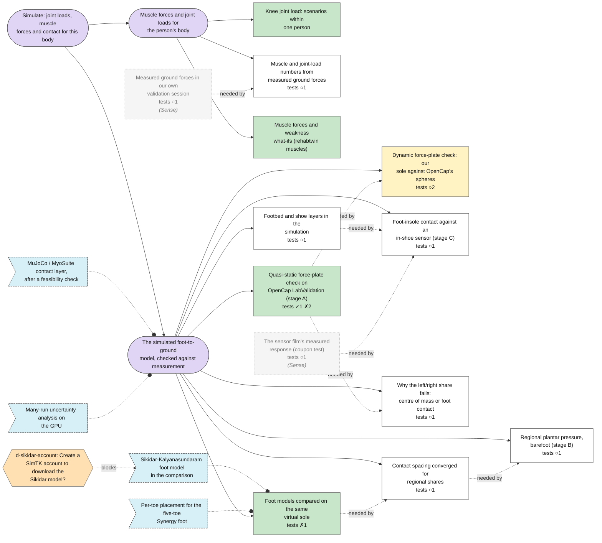
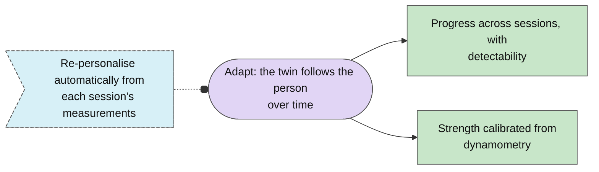
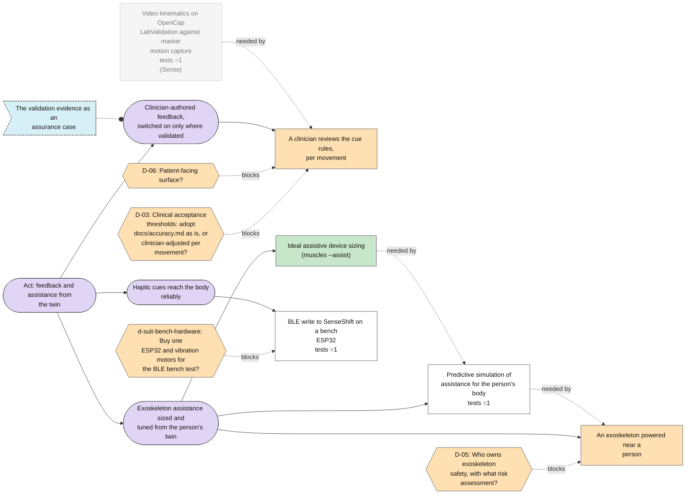
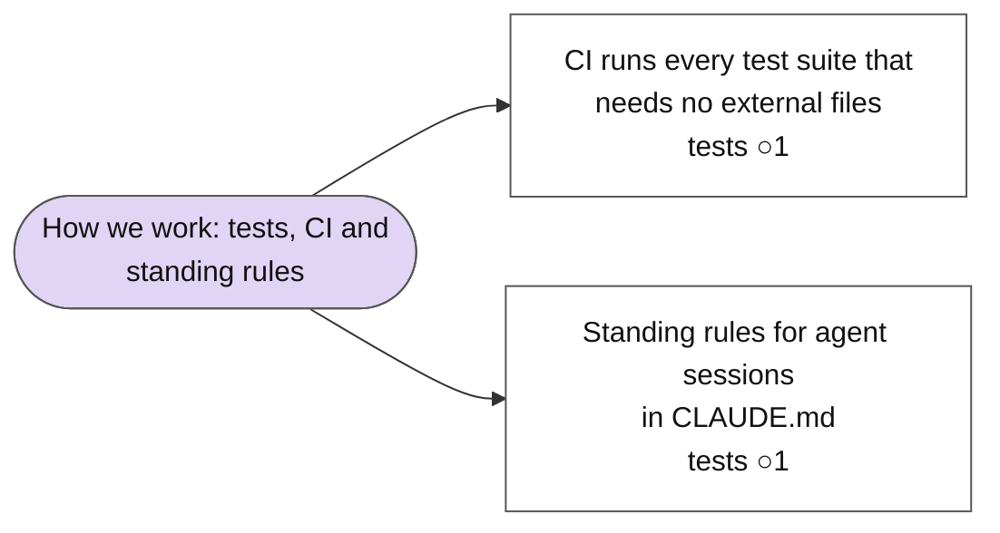

<!-- Generated by plan/build.py from plan/nodes/. Do not edit; edit the notes and run the script. -->

# Plan map

101 notes: 17 goals, 35 steps, 24 tests, 10 ideas, 15 decisions.

## The engine

```mermaid
flowchart TB
  r(["A full-body digital twin that<br/>personalises to each person and adapts<br/>as they change"]):::goal_open
  p0(["Sense: measure the person's<br/>movement, forces and body<br/><i>1 done · 7 open · 1 blocked · 2 ideas · 3 decisions</i>"]):::goal_open
  r --> p0
  p1(["Personalise: the person's own<br/>bones, shape, mass and muscles<br/><i>5 done · 1 blocked · 1 idea · 1 decision</i>"]):::goal_open
  r --> p1
  p2(["Simulate: joint loads, muscle<br/>forces and contact for this<br/>body<br/><i>4 done · 1 doing · 6 open · 4 ideas · 1 decision</i>"]):::goal_open
  r --> p2
  p3(["Adapt: the twin follows the<br/>person over time<br/><i>2 done · 1 idea</i>"]):::goal_open
  r --> p3
  p4(["Act: feedback and assistance<br/>from the twin<br/><i>1 done · 2 open · 2 blocked · 1 idea · 4 decisions</i>"]):::goal_open
  r --> p4
  p5(["How we work: tests, CI and<br/>standing rules<br/><i>2 open</i>"]):::goal_open
  r --> p5
  classDef goal_open fill:#e1d5f5,stroke:#555,color:#111
  classDef goal_done fill:#c8e6c9,stroke:#555,color:#111
  classDef step_open fill:#ffffff,stroke:#555,color:#111
  classDef step_doing fill:#fff3c4,stroke:#555,color:#111
  classDef step_done fill:#c8e6c9,stroke:#555,color:#111
  classDef step_blocked fill:#ffe0b2,stroke:#555,color:#111
  classDef step_dropped fill:#eeeeee,stroke:#555,color:#111
  classDef test_planned fill:#ffffff,stroke:#555,color:#111
  classDef test_running fill:#fff3c4,stroke:#555,color:#111
  classDef test_passed fill:#c8e6c9,stroke:#555,color:#111
  classDef test_failed fill:#ffcdd2,stroke:#555,color:#111
  classDef test_mixed fill:#fff3c4,stroke:#555,color:#111
  classDef test_dropped fill:#eeeeee,stroke:#555,color:#111
  classDef idea_new fill:#d7f0f7,stroke:#555,color:#111,stroke-dasharray: 4 3
  classDef idea_promoted fill:#eeeeee,stroke:#555,color:#111,stroke-dasharray: 4 3
  classDef idea_dropped fill:#eeeeee,stroke:#555,color:#111,stroke-dasharray: 4 3
  classDef decision_open fill:#ffe0b2,stroke:#555,color:#111
  classDef decision_decided fill:#ffe0b2,stroke:#555,color:#111
  classDef external fill:#f5f5f5,stroke:#aaa,color:#777,stroke-dasharray: 2 2
```

## Sense: measure the person's movement, forces and body

## Personalise: the person's own bones, shape, mass and muscles

## Simulate: joint loads, muscle forces and contact for this body

## Adapt: the twin follows the person over time

## Act: feedback and assistance from the twin

## How we work: tests, CI and standing rules

## Needs your input

- D-01: open decision: iPhone: fixed tripod viewpoint or moving main camera?
- D-02: open decision: MRI/CT access pathway for Tier-A onboarding?
- D-03: open decision: Clinical acceptance thresholds: adopt docs/accuracy.md as is, or clinician-adjusted per movement?
- D-04: open decision: Ground truth for kinematics validation: LabValidation now, then a gait-lab collaboration?
- D-05: open decision: Who owns exoskeleton safety, with what risk assessment?
- D-06: open decision: Patient-facing surface?
- D-07: open decision: Data jurisdiction and retention for RGB-D health data?
- D-09: open decision: SKEL/SMPL licensing for anything beyond research?
- D-10: open decision: Gravity reference for monocular captures?
- D-11: open decision: Monocular front-end: HSMR/SKEL, OpenCap Monocular or SAM4Dcap?
- d-fabricator-enquiry: open decision: Send the flex fabrication enquiry?
- d-prototype-materials: open decision: Buy the materials for the printed prototype and the coupon test?
- d-repo-visibility: open decision: Keep rehab-agent public, or make it private?
- d-sikidar-account: open decision: Create a SimTK account to download the Sikidar model?
- d-suit-bench-hardware: open decision: Buy one ESP32 and vibration motors for the BLE bench test?
- kin-labvalidation: priority-1 step needs a stop rule (a number, a date, an owner)
- sole-physical-prototype: priority-1 step needs a stop rule (a number, a date, an owner)
- t-coupon: no expected result: write it before the test runs
- t-exo-assist: no expected result: write it before the test runs
- t-footbed: no expected result: write it before the test runs
- t-forces-session: no expected result: write it before the test runs
- t-insole: no expected result: write it before the test runs
- t-kin-labvalidation: no expected result: write it before the test runs
- t-kin-volunteer: no expected result: write it before the test runs
- t-loads-measured-forces: no expected result: write it before the test runs
- t-prototype-press: no expected result: write it before the test runs
- t-regional: no expected result: write it before the test runs
- t-slimevr: no expected result: write it before the test runs
- t-suit-ble: no expected result: write it before the test runs

## Ready to work on now

Open steps whose dependencies are done and that no open decision blocks.

- [[exo-assist-simulation]]: Predictive simulation of assistance for the person's body
- [[kin-labvalidation]]: Video kinematics on OpenCap LabValidation against marker motion capture
- [[project-ci-suites]]: CI runs every test suite that needs no external files
- [[project-claude-md]]: Standing rules for agent sessions in CLAUDE.md
- [[sole-footbed-layers]]: Footbed and shoe layers in the simulation
- [[sole-rebuild-reproducibility]]: Boards and the self-test model rebuild identically on another machine
- [[sole-share-diagnostic]]: Why the left/right share fails: centre of mass or foot contact
- [[sole-spacing-converge]]: Contact spacing converged for regional shares
- [[suit-slimevr-validation]]: SlimeVR posture signals against motion capture

## Tests

| Test | Status | Fresh | Expected | Result |
|---|---|---|---|---|
| [[t-boards-checker]] | passed | n/a | All eight boards pass DRC, the region map traced through the copper, numbering, coverlay and provenance | All eight pass. Passing is not a release for fabrication |
| [[t-ci-suites]] | planned |  | On every push, CI runs test_channel_map, test_case_store, test_compare_results, plan/test_build and plan/build.py --check, and all pass |  |
| [[t-claude-md-fresh-session]] | planned |  | A fresh session given only a one-line task keeps every standing rule without them in the prompt |  |
| [[t-coupon]] | planned |  |  |  |
| [[t-dyn-h1]] | planned | no | Peak error at most 10 % of body weight (recorded mass) in every evaluated subject |  |
| [[t-dyn-h2]] | planned | no | RMS error at most 15 % of foot length in every evaluated subject |  |
| [[t-exo-assist]] | planned |  |  |  |
| [[t-footbed]] | planned |  |  |  |
| [[t-forces-session]] | planned |  |  |  |
| [[t-fp-cop]] | passed | yes | RMS error at most 10 % of foot length in every subject | Pass: median 2.85 %, range 0.97-6.67 %. Measured lies ahead of the model in every subject |
| [[t-fp-share]] | failed | yes | RMS error at most 5 points in every subject | Fail in six subjects. Post hoc, with plate coverage: subjects 4, 5, 7 and 10, up to 9.9 points |
| [[t-fp-vertical]] | failed | yes | RMS error at most 5 % of body weight in every subject | Fail in subjects 6, 9 and 10. Post hoc: follows the gap between recorded mass and plate weight (6 % in 6 and 10); 9 had a foot off the plates |
| [[t-insole]] | planned |  |  |  |
| [[t-kin-labvalidation]] | planned |  |  |  |
| [[t-kin-volunteer]] | planned |  |  |  |
| [[t-loads-measured-forces]] | planned |  |  |  |
| [[t-prototype-press]] | planned |  |  |  |
| [[t-rebuild-laptop]] | planned |  | The design hash is 636645a928, or the first generator step whose output differs is identified |  |
| [[t-regional]] | planned |  |  |  |
| [[t-share-lever-rule]] | planned | no | If the body model is the cause, the sideways offset between measured centre of pressure and model centre of mass predicts each failing subject's share error by the lever rule within 2 points |  |
| [[t-slimevr]] | planned |  |  |  |
| [[t-spacing-convergence]] | failed | n/a | The largest change between the two finest spacings is at most 1.0 point for every share and paired difference, shrinking each step | Not converged: 1.67 points from 3.75 to 2.5 mm. Shrinking: yes. Paired differences within 0.89 |
| [[t-spacing-finer]] | planned |  | The same criterion as the first convergence test, met at the next finer pair of spacings |  |
| [[t-suit-ble]] | planned |  |  |  |

## Open decisions

| Decision | Question | Blocks |
|---|---|---|
| [[D-01]] | iPhone: fixed tripod viewpoint or moving main camera? |  |
| [[D-02]] | MRI/CT access pathway for Tier-A onboarding? | ['[[twin-tier-a-subject]]'] |
| [[D-03]] | Clinical acceptance thresholds: adopt docs/accuracy.md as is, or clinician-adjusted per movement? | ['[[cues-clinician-review]]'] |
| [[D-04]] | Ground truth for kinematics validation: LabValidation now, then a gait-lab collaboration? |  |
| [[D-05]] | Who owns exoskeleton safety, with what risk assessment? | ['[[exo-hardware]]'] |
| [[D-06]] | Patient-facing surface? | ['[[cues-clinician-review]]'] |
| [[D-07]] | Data jurisdiction and retention for RGB-D health data? | ['[[kin-volunteer-recording]]'] |
| [[D-09]] | SKEL/SMPL licensing for anything beyond research? |  |
| [[D-10]] | Gravity reference for monocular captures? |  |
| [[D-11]] | Monocular front-end: HSMR/SKEL, OpenCap Monocular or SAM4Dcap? |  |
| [[d-fabricator-enquiry]] | Send the flex fabrication enquiry? | ['[[sole-fabrication]]'] |
| [[d-prototype-materials]] | Buy the materials for the printed prototype and the coupon test? | ['[[sole-physical-prototype]]', '[[sole-coupon-test]]'] |
| [[d-repo-visibility]] | Keep rehab-agent public, or make it private? |  |
| [[d-sikidar-account]] | Create a SimTK account to download the Sikidar model? | ['[[idea-sikidar]]'] |
| [[d-suit-bench-hardware]] | Buy one ESP32 and vibration motors for the BLE bench test? | ['[[suit-ble-bench]]'] |

## Ideas

| Idea | Status | Title |
|---|---|---|
| [[idea-assistance-track]] | promoted | Predictive simulation of assistance |
| [[idea-assurance-case]] | new | The validation evidence as an assurance case |
| [[idea-auto-repersonalise]] | new | Re-personalise automatically from each session's measurements |
| [[idea-balance-board]] | new | A consumer balance board for our own quiet-standing measurements |
| [[idea-mujoco]] | new | MuJoCo / MyoSuite contact layer, after a feasibility check |
| [[idea-sikidar]] | new | Sikidar-Kalyanasundaram foot model in the comparison |
| [[idea-synergy-toes]] | new | Per-toe placement for the five-toe Synergy foot |
| [[idea-t1-candidate]] | new | Higher-resolution T1 sole candidate |
| [[idea-thoracolumbar-model]] | new | Thoracolumbar full-body model, for a later spine-load study |
| [[idea-uncertainty-runs]] | new | Many-run uncertainty analysis on the GPU |

## Check

0 errors, 0 warnings.
